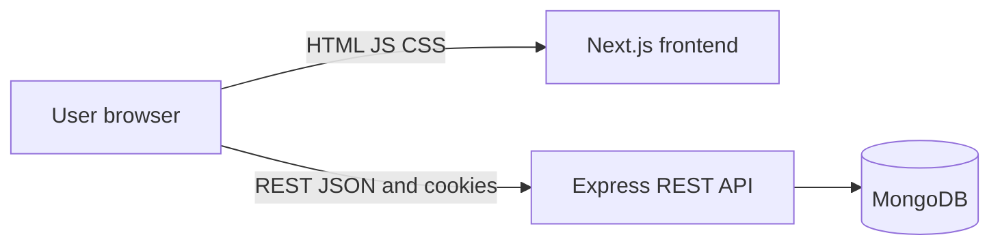

# Doctor Tracker — Backend API

## Project links

| Item | URL |
|------|-----|
| Live API base | https://doctor-tracker-backend-c1v8.onrender.com/api/v1 |
| Health check | https://doctor-tracker-backend-c1v8.onrender.com/api/v1/health |
| Backend repository | https://github.com/erfan-sahil/doctor-tracker-backend |
| Frontend app | https://doctor-tracker-taupe.vercel.app/ |
| Frontend documentation | https://github.com/erfan-sahil/doctor-tracker-client/blob/main/README.md |

---

## A. Description

**Doctor Tracker** is a secure administrative platform for managing doctors and patients. This repository is the **standalone Express + TypeScript REST API** backed by **MongoDB**. It provides JWT-based authentication with refresh cookies, role-based authorization, validated CRUD for doctors and patients, and aggregated dashboard analytics. The [Next.js client](https://github.com/erfan-sahil/doctor-tracker-client/blob/main/README.md) runs separately; browsers call this API directly (CORS + credentials), not through Next.js server routes.

---

## Beyond the assignment

### Role-based access control (Doctor role)

The brief required an authenticated **admin** managing all doctors and patients. This API additionally implements a **doctor** role:

- **Admin:** Full doctor CRUD, all patients, dashboard.
- **Doctor:** Dashboard and patient routes only; lists and mutations are **scoped** to `actor.doctorId` in [`src/modules/patient/patient.service.ts`](src/modules/patient/patient.service.ts). Doctor routes are **admin-only** via [`authorize("admin")`](src/middlewares/authorize.middleware.ts) in [`src/modules/doctor/doctor.route.ts`](src/modules/doctor/doctor.route.ts).

RBAC is enforced in the **service layer**, not only in the UI, so unauthorized access cannot rely on hiding buttons in the client.

### Docker and Docker Compose

Docker was **not required** by the assignment. This repo includes an optional **multi-stage** [`Dockerfile`](Dockerfile), [`docker-compose.yml`](docker-compose.yml) (API + MongoDB 7), [`docker-compose.local.yml`](docker-compose.local.yml) for exposing Mongo on localhost, `npm run env:init`, and compose-related npm scripts for one-command local stacks. **Production on Render does not require Docker**—you can run `npm run build` and `npm start` with a managed MongoDB URI.

---

## B. Setup guide

### Prerequisites

- Node.js 20+ (see [`package.json`](package.json))
- npm
- MongoDB (local instance, [MongoDB Atlas](https://www.mongodb.com/atlas), or the Compose service below)

### Installation

```bash
git clone https://github.com/erfan-sahil/doctor-tracker-backend.git
cd doctor-tracker-backend
npm ci
```

### Environment variables

One [`.env`](.env) file (gitignored) powers local dev, seeds, and Docker Compose. Start from the example:

```bash
cp .env.example .env
npm run env:init   # first time only: random JWT secrets, admin password, SEED_ADMIN=true
```

| Variable | Description |
|----------|-------------|
| `NODE_ENV` | `development` or `production` |
| `PORT` | API port inside the process (default `5000`) |
| `MONGODB_URI` | MongoDB connection string |
| `CORS_ORIGIN` | Allowed browser origin (e.g. `http://localhost:3000` or Vercel URL) |
| `ACCESS_TOKEN_SECRET` / `REFRESH_TOKEN_SECRET` | JWT signing secrets (32+ chars) |
| `ACCESS_TOKEN_TTL` / `REFRESH_TOKEN_TTL` | Token lifetimes (e.g. `15m`, `7d`) |
| `ADMIN_NAME`, `ADMIN_EMAIL`, `ADMIN_PASSWORD` | Initial admin when seeding |
| `SEED_ADMIN` | `true` to run admin seed on startup (Docker entrypoint or manual script) |

See [`.env.example`](.env.example) for defaults.

**MongoDB URI by environment:**

- **Local `npm run dev`:** `mongodb://127.0.0.1:27017/doctor-tracker?retryWrites=false` (as in `.env.example`)
- **Docker Compose:** set `MONGODB_URI=mongodb://mongodb:27017/doctor-tracker` (hostname matches the `mongodb` service in [`docker-compose.yml`](docker-compose.yml)). The example file still shows `127.0.0.1`—change it when using Compose.

### Run locally (no Docker)

1. Ensure MongoDB is reachable at `MONGODB_URI`.
2. Set `CORS_ORIGIN=http://localhost:3000` (or your frontend origin).
3. With `SEED_ADMIN=true`, start the API once to create the admin, then set `SEED_ADMIN=false`.

```bash
npm run dev
```

API: http://localhost:5000/api/v1  
Health: http://localhost:5000/api/v1/health

Optional sample data:

```bash
npm run seed:mock
```

### Run with Docker (optional)

```bash
npm run env:init    # if .env does not exist yet
# Set MONGODB_URI=mongodb://mongodb:27017/doctor-tracker in .env before compose
docker compose up
```

Use `-d` for detached mode. The API is published on the host at **port 5001** by default (`API_HOST_PORT`, mapped to container port 5000).

- API: http://localhost:5001/api/v1
- Health: http://localhost:5001/api/v1/health

After the first successful run with `SEED_ADMIN=true`, set `SEED_ADMIN=false` in `.env` and restart.

**MongoDB Compass / mongosh on host:** Mongo is not exposed by default. To bind MongoDB to localhost only:

```bash
docker compose -f docker-compose.yml -f docker-compose.local.yml up
```

**Stop:**

```bash
docker compose down
```

Helper scripts: `npm run docker:up`, `docker:up:local`, `docker:down`, `docker:logs`, `docker:seed`.

### Frontend pairing

Run the [frontend client](https://github.com/erfan-sahil/doctor-tracker-client/blob/main/README.md#b-setup-guide) with:

- Docker API: `NEXT_PUBLIC_API_URL=http://localhost:5001/api/v1`
- Local API: `NEXT_PUBLIC_API_URL=http://localhost:5000/api/v1`

### Tests

```bash
npm test
```

Vitest with in-memory MongoDB covers auth rotation, RBAC on routes, and related flows (see [`tests/auth.test.ts`](tests/auth.test.ts)).

### Production (Render)

- Set `NODE_ENV=production`, strong secrets, and `MONGODB_URI` to your cluster.
- Set `CORS_ORIGIN` to the live frontend: `https://doctor-tracker-taupe.vercel.app`
- Do not use `docker-compose.local.yml` on a public server.

### Submission and credentials

- **Hosted API / app:** Production database and login credentials are **not** published in this repository. Evaluators receive a **dedicated demo account** in the **submission email / evaluation packet**.
- **Local evaluation:** After `npm run env:init`, read `ADMIN_EMAIL` and `ADMIN_PASSWORD` from your local `.env` only—never commit `.env`.

---

## C. System architecture

### High-level data flow

The browser loads the Next.js UI from Vercel. **All REST traffic** is sent from the browser to this Express service. Next.js does not proxy API requests.



### Request pipeline

[`src/app.ts`](src/app.ts): Helmet, CORS (credentials), compression, JSON body, cookies, rate limiting → [`src/routes/index.ts`](src/routes/index.ts) → module routers → controllers → services → Mongoose → centralized error handling.

### API surface

Base path: `/api/v1`

| Mount | Module |
|-------|--------|
| `/health` | Liveness |
| `/auth` | Login, refresh, me, logout |
| `/dashboard` | Aggregated analytics |
| `/doctors` | Doctor management |
| `/patients` | Patient management |

### Authentication flow

1. **`POST /auth/login`** — Validates credentials; returns **access token** in JSON; sets **httpOnly** refresh cookie ([`src/modules/auth/auth.service.ts`](src/modules/auth/auth.service.ts)).
2. **`POST /auth/refresh`** — Rotates refresh session; returns new access token; updates cookie.
3. **`GET /auth/me`** — Requires `Authorization: Bearer <accessToken>`.
4. **`POST /auth/logout`** — Revokes refresh session and clears cookie.

Refresh tokens are hashed and stored in MongoDB; reuse detection revokes the session family (tested in [`tests/auth.test.ts`](tests/auth.test.ts)).

### Authorization matrix

| Resource | Admin | Doctor |
|----------|-------|--------|
| `POST/GET/PATCH/DELETE /doctors/*` | Yes | No |
| `GET /doctors/:id/patients` | Yes | No |
| `POST/GET/PATCH/DELETE /patients/*` | All records | Own `doctorId` only |
| `GET /dashboard` | Yes | Yes |

Enforcement: [`src/modules/doctor/doctor.route.ts`](src/modules/doctor/doctor.route.ts), [`src/modules/patient/patient.route.ts`](src/modules/patient/patient.route.ts), [`src/modules/patient/patient.service.ts`](src/modules/patient/patient.service.ts).

### Backend layout

```
src/
  config/        env validation, DB connection
  middlewares/   authenticate, authorize, validate, errors
  modules/       auth, user, doctor, patient, dashboard
  routes/        /api/v1 wiring
  utils/         tokens, cookies, ApiError, logger
tests/           API integration tests
```

---

## D. Technical decisions

### JWT access tokens and rotating refresh sessions

Short-lived **access tokens** limit exposure if an XSS attacker reads memory. **Refresh tokens** live in httpOnly cookies and are stored as hashes in MongoDB with rotation on each refresh. Parallel refresh calls from the client are deduplicated on the frontend; the backend rejects refresh reuse to contain token theft.

### Compound MongoDB indexes

Filtered pagination and sorting are backed by explicit indexes, for example:

- Patients: `{ doctorId: 1, date: -1 }`, `{ condition: 1, date: -1 }` — [`src/modules/patient/patient.model.ts`](src/modules/patient/patient.model.ts)
- Doctors: `{ createdAt: -1, _id: -1 }` — [`src/modules/doctor/doctor.model.ts`](src/modules/doctor/doctor.model.ts)

This keeps list and filter queries from scanning full collections as data grows.

### Layered module design

Each domain uses **routes → controllers → services → models**. **Zod** schemas validate params, query, and body in middleware. Business rules (e.g. doctor-scoped patients) stay in services, not in route handlers.

### Centralized API errors and responses

`ApiError` plus error middleware return a consistent `{ success, message, data }` shape. Validation failures and 401/403 responses behave predictably for the React client.

### Security middleware defaults

Helmet, global rate limiting, and stricter limits on auth endpoints reduce brute-force and accidental overload ([`src/app.ts`](src/app.ts), [`src/modules/auth/auth.route.ts`](src/modules/auth/auth.route.ts)).

---

## API quick reference

All protected routes require `Authorization: Bearer <accessToken>` unless noted. Refresh uses the httpOnly cookie on `/auth/refresh` and `/auth/login`.

| Method | Path | Auth | Roles |
|--------|------|------|-------|
| GET | `/health` | No | — |
| POST | `/auth/login` | No | — |
| POST | `/auth/refresh` | Cookie | — |
| GET | `/auth/me` | Bearer | Any active user |
| POST | `/auth/logout` | Cookie optional | — |
| GET | `/dashboard` | Bearer | Admin, Doctor |
| POST | `/doctors` | Bearer | Admin |
| GET | `/doctors` | Bearer | Admin |
| GET | `/doctors/filters` | Bearer | Admin |
| GET | `/doctors/:id` | Bearer | Admin |
| GET | `/doctors/:id/patients` | Bearer | Admin |
| PATCH | `/doctors/:id` | Bearer | Admin |
| DELETE | `/doctors/:id` | Bearer | Admin |
| POST | `/patients` | Bearer | Admin, Doctor |
| GET | `/patients` | Bearer | Admin, Doctor (scoped) |
| GET | `/patients/filters` | Bearer | Admin, Doctor |
| GET | `/patients/:id` | Bearer | Admin, Doctor (scoped) |
| PATCH | `/patients/:id` | Bearer | Admin, Doctor (scoped) |
| DELETE | `/patients/:id` | Bearer | Admin, Doctor (scoped) |

List endpoints support pagination, search, and filters via query parameters (validated in each module’s Zod schemas).

---

## E. Visual evidence

UI screenshots (desktop and mobile) are maintained in the [frontend repository](https://github.com/erfan-sahil/doctor-tracker-client/blob/main/README.md#e-visual-evidence) under `public/screenshot/`.

---

## Features implemented (API)

- Secure login, logout, session refresh, inactive account handling
- Admin doctor lifecycle (create with login user, list, filter, update, delete, patient list per doctor)
- Patient CRUD with assignment to doctors, filters (date, condition, doctor, search)
- Dashboard aggregation (counts, per-doctor patient totals, time-based trends)
- Input validation, duplicate email prevention, efficient paginated queries
- Vitest coverage for authentication and admin/doctor route guards

For UI navigation, charts, and UX patterns, see the [frontend README](https://github.com/erfan-sahil/doctor-tracker-client/blob/main/README.md).